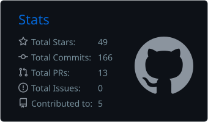

# Emmanuel Nana Nana

**Applied Mathematics & Physics @ TH Nürnberg** · scientific computing · machine learning · Python backend

I turn what I study into tested code: numerical methods, statistical research pipelines and full-stack systems. Founder of [AlgoSphere Quant](https://algosphere-quant.com), 14 commercial trading products on the MQL5 Marketplace.

### 🎯 Open to

| Role | When | Where | Fields |
|---|---|---|---|
| **Werkstudent** (working student, part-time) | from Feb 2027 | Remote | Python · data & ML · scientific computing · backend (FastAPI) |
| **Pflichtpraktikum** (mandatory internship, 16 weeks) | from Aug 2027 | Nürnberg area, on-site or hybrid | the same fields, plus embedded C/C++ |

Ideally with the same company: the Werkstudent position can turn into my mandatory internship from Aug 2027.

📫 [e49nana@gmail.com](mailto:e49nana@gmail.com) · [LinkedIn](https://www.linkedin.com/in/emmanuel-nana)

### 📌 Projects

| Repo | What it is | Stack |
|---|---|---|
| [**Djibril-AI**](https://github.com/e49nana/Djibril-AI) | AI-assisted crude-oil trading system: signal collectors, geopolitical scoring via the Claude API, FastAPI backend, React/TS dashboard, MT5 execution. 98 tests, CI. | Python · FastAPI · React/TS · Docker |
| [**lokus-research**](https://github.com/e49nana/lokus-research) | Quantitative research on intraday futures: walk-forward protocol, sealed holdout, bootstrap confidence intervals, Bonferroni correction. 428 tests, CI. | Python · pandas · scikit-learn · pytest |
| [**Algorithmic-trading**](https://github.com/e49nana/Algorithmic-trading) | Open-source MetaTrader 5 and NinjaTrader 8 tools, plus the AlgoSphere Quant showcase. | MQL5 · C# |
| [**hansi-ai-goggles**](https://github.com/e49nana/hansi-ai-goggles) | DIY AI smart goggles: two ESP32-S3 firmwares (camera/mic/BLE server, LVGL HUD) and a browser companion app with GPT-4o vision (demo mode). | C++ · ESP32-S3 · BLE · LVGL |

**In progress, not public yet:** `pde-blocks`, neural-network building blocks derived from PDE discretisation schemes, with a benchmark (Anwendungsprojekt "Physical AI", TH Nürnberg).

### 🛠️ Stack

**Languages**     

**Data & ML**    

**Backend**   

**Testing**  

**Embedded**  

### 📚 Now

- **WiSe 2026/27** — Numerik (Grundlagen & gewöhnliche DGL), Lineare und Nichtlineare Optimierung, Funktionalanalysis, Physik IV (Kerne und Teilchen), Anwendungsprojekt *Physical AI*.
- **SS 2027** — Erasmus+ at ISEL, Instituto Politécnico de Lisboa: algorithms & data structures, statistical data modelling, optimization, advanced modelling & simulation.
- **Expected graduation** — B.Sc., SS 2028.

**Languages:** French (native) · German (C1, telc C1 Hochschule) · English (B2+, DAAD) · Spanish (A1) · Russian (A1)

### 📊 Activity

 
